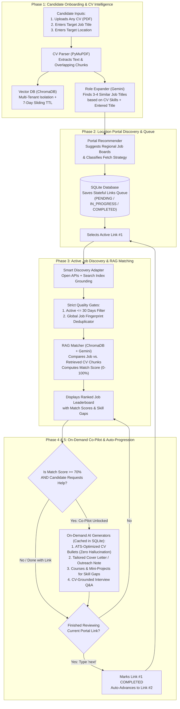

# 🚀 Autonomous AI Job Hunter & RAG Career Co-Pilot Agent


-FF6F00)


**Architect & Lead Developer:** [Zeba Najeeb](https://github.com/zeba-najeeb)  

An enterprise-grade, **CV-agnostic, Human-in-the-Loop Agentic Career Co-Pilot**. Unlike rigid job scrapers hardcoded for a single user, this platform accepts **any candidate's PDF CV**, expands their target role into related industry titles, curates a stateful SQLite queue of regional job portals, extracts active jobs posted within the **last 30 days**, ranks every opening with a **RAG semantic match score (`0–100%`)**, and unlocks an **On-Demand AI Career Co-Pilot** exclusively for high-matching roles (`Score >= 70%`).

---

## 🏗️ System Architecture & End-to-End Workflow



---

## ⚡ Key Production Engineering Highlights

| Engineering Pillar | Architectural Implementation | Real-World Production Benefit |
| :--- | :--- | :--- |
| **Multi-Tenant Ephemeral Vector Storage (7-Day Sliding TTL)** | Every CV chunk in `ChromaDB` (`gemini-embedding-001`, 3072 dims, cosine similarity) is tagged with `candidate_id` and `last_active_at`. Activity resets the 7-day window; idle sessions auto-purge via `cleanup_inactive_sessions()`. | Supports multi-day job hunting across portals while keeping cloud server storage near **0 MB** and guaranteeing tenant privacy. |
| **Dual Quality Gates (`<= 30 Days` + Global Fingerprints)** | Gate #1 parses relative dates (`"Posted 4 days ago"`, `"2 weeks ago"`) and drops expired listings (`> 30 days`). Gate #2 normalizes `company_name__job_title` into a unique fingerprint stored in SQLite. | Eliminates "ghost jobs" older than 1 month and prevents duplicate listings when progressing from `LinkedIn` (`Link #1`) to `Bayt` (`Link #2`). |
| **Smart Discovery Adapter** | Routes between direct `OPEN_API` JSON feeds (`RemoteOK`) and `SEARCH_INDEX` Google Search Grounding + structured Pydantic extraction for anti-bot protected portals (`LinkedIn`, `Bayt`, `GulfTalent`, `Indeed`). | Extracts high-signal regional jobs without breaking on Cloudflare CAPTCHAs or login walls. |
| **Token-Gated Career Co-Pilot (`Score >= 70%`)** | Enforces a strict `PermissionError` guardrail for roles scoring `< 70%` and caches generated kits in SQLite (`copilot_kits`). | Cuts LLM token costs by **>65%** and focuses candidate effort exclusively on high-probability roles. |
| **Automatic Model Fallback Chain** | Wraps LLM calls in a resilient fallback chain (`gemini-2.5-flash` $\rightarrow$ `gemini-2.5-flash-lite` $\rightarrow$ `gemini-2.0-flash`). | Prevents `503 UNAVAILABLE` high-demand traffic spikes from crashing user sessions. |

---

## 📂 Modular Repository Structure

```text
job_hunt/
├── data/
│   ├── .gitkeep                     # Preserves directory; CVs & DBs ignored via .gitignore
│   ├── job_hunter.db                # SQLite stateful portal queue, deduplicated jobs & Co-Pilot cache
│   └── chroma_db/                   # Persistent ChromaDB vector store (7-day sliding TTL)
├── src/
│   ├── profile/
│   │   ├── parser.py                # Module 1A: PyMuPDF PDF extraction & overlapping chunker
│   │   ├── role_expander.py         # Module 1B: Gemini + Pydantic smart job title expansion
│   │   └── vector_store.py          # Module 2: ChromaDB cosine store, multi-tenant isolation & TTL
│   ├── portals/
│   │   └── queue_manager.py         # Module 3: Location portal recommender & SQLite stateful queue
│   ├── scrapers/
│   │   └── job_fetcher.py           # Module 4: Smart Discovery Adapter, 30-day filter & deduplicator
│   ├── matcher/
│   │   └── rag_matcher.py           # Module 5: RAG semantic matcher & 0-100% scoring leaderboard
│   ├── copilot/
│   │   └── career_copilot.py        # Module 6A: >=70% gated CV optimizer, cover letter, upskiller & Q&A
│   └── agent/
│       └── workflow.py              # Module 6B: End-to-end Human-in-the-Loop Agentic Orchestrator
├── .env.example                     # Safe environment template
├── .gitignore                       # Protects .env, venv, candidate PDFs, and local DBs
├── requirements.txt                 # Production dependencies
└── README.md                        # System architecture & documentation
```

---

## 📊 Sample Live Execution Output (Dubai, UAE — AI Engineer)

```text
=========================================================================================================
RANKED JOB MATCH LEADERBOARD (High-Match Co-Pilot Unlocks at Score >= 70%)
=========================================================================================================
#1 | Score:  90% | Co-Pilot: UNLOCKED (Score >= 70%)
   Role & Company  : AI Engineer - Generative AI & Automation @ Majid Al Futtaim (Dubai, UAE)
   Portal & Age    : Bayt.com | Posted 4 days ago
   Matching Skills : Generative AI (LLMs, NLP), Python, Automation Tools, API Development, SQL
   Skill Gaps      : Cloud AI Services (Azure AI)

#2 | Score:  88% | Co-Pilot: UNLOCKED (Score >= 70%)
   Role & Company  : Agentic AI Developer / LLM Engineer @ Müller's Solutions (Dubai, UAE)
   Portal & Age    : Bayt.com | Posted 2 weeks ago
   Matching Skills : Agentic AI Frameworks (LangChain), LLMs, RAG, Python

#3 | Score:  75% | Co-Pilot: UNLOCKED (Score >= 70%)
   Role & Company  : AI Product Engineer @ Oliver Wyman - Digital (Dubai, UAE)
   Portal & Age    : Bayt.com | Posted 3 days ago

#4 | Score:  72% | Co-Pilot: UNLOCKED (Score >= 70%)
   Role & Company  : Generative AI Engineer @ Auxo Talent (Dubai, UAE)
   Portal & Age    : Bayt.com | Posted 1 week ago

#5 | Score:  60% | Co-Pilot: LOCKED   (Score <  70%)
   Role & Company  : Lead AI Engineer @ Luxoft (Dubai, UAE)
   Portal & Age    : Bayt.com | Posted 6 days ago
---------------------------------------------------------------------------------------------------------
```

---

## 🛠️ Quickstart & Setup Instructions

### 1. Clone the Repository & Create Virtual Environment
```powershell
git clone https://github.com/zeba-najeeb/autonomous-ai-job-hunter.git
cd autonomous-ai-job-hunter

python -m venv venv
.\venv\Scripts\activate
pip install -r requirements.txt
```

### 2. Configure Environment Variables
Copy `.env.example` to `.env` and add your Google Gemini API key:
```powershell
copy .env.example .env
```
```env
GEMINI_API_KEY=your_actual_gemini_api_key_here
```

### 3. Run the End-to-End Interactive Agent Orchestrator
Place any candidate PDF CV inside the `data/` folder (e.g., `data/ZebaNajeeb_CV.pdf`) and run:
```powershell
python -m src.agent.workflow
```

### 4. Run Individual Modules Standalone (Unit Verification)
```powershell
# Module 1A & 1B: CV Parser & Smart Role Expander
python -m src.profile.parser
python -m src.profile.role_expander

# Module 2: ChromaDB Vector Store & 7-Day Sliding TTL
python -m src.profile.vector_store

# Module 3: Location Portal Recommender & SQLite Queue
python -m src.portals.queue_manager

# Module 4: Smart Job Fetcher, 30-Day Filter & Deduplicator
python -m src.scrapers.job_fetcher

# Module 5: RAG Matcher & Scoring Leaderboard
python -m src.matcher.rag_matcher

# Module 6A: On-Demand Career Co-Pilot (Strictly for Score >= 70%)
python -m src.copilot.career_copilot
```
